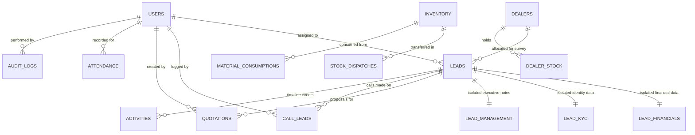

# Mirror Solar Vision CRM &mdash; Database Schema Specification

**Project Owner:** Mirror Solar Vision  
**Database:** Google Cloud Firestore (Multi-Region)  
**Project ID:** `crm-webapp-d32bc`  
**Architecture Authority:** ChatGPT & Antigravity Engineering  
**Version:** 3.0.0-PROD  
**Date:** November 3, 2026  

---

## 1. Entity Relationship & Foreign-Key Topology

---

## 2. Comprehensive Collection Specifications

### 2.1 `/users` &mdash; Employee & System User Accounts
* **Document ID:** Firebase Auth UID (e.g. `DonOutQurqZiXvjvFu77iZLDhDU2`) or Legacy ID (`emp_001`)
* **Purpose:** Stores employee profile, roles, category, and capability permissions.
* **Security Gate:** Authenticated read; Admin-only write (users can update phone/avatar only).

| Field Name | Type | Constraints / Enum | Description |
|---|---|---|---|
| `id` | `string` | Primary Key | User UID matching Firebase Authentication |
| `name` | `string` | Required | Full display name of employee |
| `email` | `string` | Required, Indexed | Corporate or operational login email |
| `phone` | `string` | Required | Contact phone number |
| `role` | `string` | `'Admin' \| 'Employee' \| 'Dealer' \| 'Accounts'` | System access role |
| `employeeCategory` | `string` | `'Telecaller' \| 'Sales Manager' \| 'PM Surya Ghar Work Incharge' \| 'Stock Incharge' \| 'Accounts'` | Departmental specialization |
| `employeeCode` | `string` | Optional | Official employee ID (e.g. `MSV-EMP-001`) |
| `status` | `string` | `'Active' \| 'Away' \| 'Offline' \| 'Inactive'` | Real-time employment & session status |
| `availabilityStatus` | `string` | `'Active' \| 'On Leave' \| 'Temporarily Unavailable'` | Lead assignment eligibility flag |
| `permissions` | `map` | Required | Granular boolean capabilities |
| `responsibilities` | `map` | Optional | Job descriptions, KPI targets, primary responsibilities |
| `lastActive` | `timestamp` | Optional | ISO-8601 string of last client interaction |
| `createdAt` | `timestamp` | Required | Record creation timestamp |

---

### 2.2 `/dealers` &mdash; Regional Solar Dealer Network
* **Document ID:** Dealer Code (e.g. `MSV/DLR/01`) or UID
* **Purpose:** Stores dealer corporate profile, authorized territory, and commission tiers.
* **Security Gate:** Authenticated read; Admin-only write.

| Field Name | Type | Constraints / Enum | Description |
|---|---|---|---|
| `id` | `string` | Primary Key | Unique dealer code or UID |
| `name` | `string` | Required | Registered business / proprietor name |
| `dealerCode` | `string` | Unique, Indexed | Formatted code (e.g. `MSV/DLR/01`) |
| `phone` | `string` | Required | Registered mobile number |
| `email` | `string` | Required | Primary business email |
| `territory` | `string` | Required | Authorized district/region (e.g. 'Krishna / Vijayawada') |
| `status` | `string` | `'Active' \| 'Inactive'` | Current operating status |
| `gstNumber` | `string` | Optional | Corporate GST identification number |
| `commissionRatePerKw` | `number` | Optional | Contracted commission per kW installed (₹) |
| `features` | `map` | Optional | Enabled portal modules |

---

### 2.3 `/leads` &mdash; Core Sales Opportunities
* **Document ID:** Auto-generated ID (`lead_1729012345`)
* **Purpose:** Operational lead data accessible to sales staff and assigned dealers.
* **Security Gate:** Scoped read (assigned employee or allocated dealer); Field-level update allowlists.

| Field Name | Type | Constraints / Enum | Description |
|---|---|---|---|
| `id` | `string` | Primary Key | Unique lead identifier |
| `customer` | `string` | Required | Customer full name |
| `phone` | `string` | Required, Indexed | Customer contact number (E.164 normalized) |
| `email` | `string` | Optional | Customer email |
| `location` | `string` | Required | Town, District, State |
| `assignedEmployeeId` | `string` | Indexed | UID of assigned telecaller / sales rep |
| `assignedEmployee` | `string` | Optional | Name of assigned telecaller |
| `leadOwnerId` | `string` | Optional | Owner UID for commission / accountability |
| `dealerId` | `string` | Optional, Indexed | UID of assigned regional dealer for site survey |
| `dealer` | `string` | Optional | Name of assigned dealer |
| `dealerStatus` | `string` | `'None' \| 'Requested' \| 'Approved' \| 'Rejected'` | Dealer allocation status (Admin approved) |
| `salesStage` | `string` | 12-Stage Enum | Current progression stage in sales funnel |
| `stage` | `string` | Legacy Stage Enum | Operational bucket (`Lead \| Qualified \| Opportunity \| Converted`) |
| `priority` | `string` | `'High' \| 'Medium' \| 'Low'` | Operational priority |
| `source` | `string` | Required | Lead source (Website, Meta, Walk-in, Referral) |
| `firstCallAttemptAt` | `timestamp` | Optional | Timestamp of initial telecaller dial attempt |
| `slaStatus` | `string` | `'SLA Met' \| 'SLA Breached' \| 'Pending First Call'` | 15-minute response SLA tracking |
| `qualificationData` | `map` | Optional | 4-pillar technical & consumption specs |
| `leadScore` | `map` | Optional | Total score (0-100) and category (Hot/Warm/Cold) |
| `followUp` | `map` | Optional | Scheduled callback/visit date, time, and status |
| `payments` | `map` | Optional | Customer payment entries and summary totals |
| `installationApprovalStatus` | `string` | `'None' \| 'Pending' \| 'Approved'` | Admin installation authorization gate |
| `createdAt` | `timestamp` | Required | Record creation timestamp |
| `updatedAt` | `timestamp` | Required | Last update timestamp |
| `archived` | `boolean` | Default: `false` | Soft-delete status |

---

### 2.4 Document Separation Collections (Zero-Knowledge Isolation)

#### A. `/leadFinancials/{leadId}`
* **Security Gate:** Strictly restricted to Super Admin and Accounts (`isAdmin() || isAccounts()`).
* **Fields:** `leadId`, `grossMargin`, `contractValue`, `discomNetMeteringFee`, `dealerCommissionAmount`, `settlementStatus`, `bankAccountNumber`, `bankIfsc`, `bankName`.

#### B. `/leadKyc/{leadId}`
* **Security Gate:** Strictly restricted to Super Admin and PM Surya Ghar Incharge (`isAdmin() || isSuryaGharIncharge()`).
* **Fields:** `leadId`, `aadhaarNumberEncrypted`, `panNumber`, `electricityConsumerNumber`, `nationalPortalAppNumber`, `sanctionedLoadKw`, `discomCircle`.

#### C. `/leadManagement/{leadId}`
* **Security Gate:** Strictly restricted to Super Admin and Sales Manager (`isAdmin() || isSalesManager()`).
* **Fields:** `leadId`, `internalExecutiveNotes`, `commissionOverrideAuthorized`, `specialDiscountApprovedBy`, `competitorLossAnalysis`.

---

### 2.5 `/call_leads` &mdash; Telecalling Dial Desk Logs
* **Document ID:** Auto-generated ID (`CALL_1729012345`)
* **Purpose:** Audit record of every incoming and outgoing customer call.
* **Security Gate:** Telecallers read own calls; Managers & Admin read team calls.

| Field Name | Type | Description |
|---|---|---|
| `id` | `string` | Primary Key |
| `leadId` | `string` | Foreign Key to `/leads/{leadId}` |
| `customerName` | `string` | Customer name |
| `phone` | `string` | Contact phone dialed |
| `callDirection` | `string` | `'Outgoing' \| 'Incoming'` |
| `durationSeconds` | `number` | Call duration in seconds |
| `outcome` | `string` | `'Connected - Interested' \| 'Busy' \| 'No Answer' \| ...` |
| `notes` | `string` | Detailed discussion summary |
| `nextFollowUpDate` | `string` | Follow-up scheduled date (YYYY-MM-DD) |
| `nextFollowUpTime` | `string` | Follow-up scheduled time |
| `telecallerId` | `string` | UID of calling employee |
| `telecallerName` | `string` | Name of calling employee |
| `timestamp` | `timestamp` | Call timestamp |

---

### 2.6 `/quotations` &mdash; Commercial Solar Proposals
* **Document ID:** Auto-generated ID (`QT_1729012345`)
* **Purpose:** Sizing, line items, pricing, discounts, and PM Surya Ghar subsidy estimates.
* **Security Gate:** Creator/Dealer scoped read; Admin/Accounts discount approval.

| Field Name | Type | Description |
|---|---|---|
| `id` | `string` | Primary Key |
| `quotationNumber` | `string` | Formatted number (e.g. `MS-QT-2026-001`) |
| `leadId` | `string` | Foreign Key to `/leads/{leadId}` |
| `customerName` | `string` | Customer name |
| `customerPhone` | `string` | Contact phone |
| `systemSizeKw` | `number` | Rated solar plant capacity in kW |
| `basePriceAtCreation` | `number` | Catalog base price (₹) |
| `discount` | `number` | Discount amount applied (₹) |
| `discountApprovalStatus` | `string` | `'None' \| 'Pending' \| 'Approved' \| 'Rejected'` |
| `finalAmount` | `number` | Gross payable invoice amount |
| `subsidyEstimateAtCreation` | `number` | Estimated PM Surya Ghar Central Subsidy (₹) |
| `netCustomerCost` | `number` | Net cost after central subsidy (₹) |
| `status` | `string` | `'Draft' \| 'Sent' \| 'Approved' \| 'Rejected' \| 'Amended'` |
| `items` | `array<map>` | Line item BOM specs (Modules, Inverter, Structure, Cables) |
| `createdBy` | `string` | UID of proposal creator |
| `createdByName` | `string` | Name of proposal creator |
| `createdAt` | `timestamp` | Proposal generation timestamp |

---

### 2.7 `/inventory` &mdash; Central Equipment Stock
* **Document ID:** SKU / Item Code (e.g. `INV-MOD-550W`)
* **Purpose:** Physical warehouse stock levels, specifications, unit rates.
* **Security Gate:** Authenticated read; Admin & Stock Incharge write.

| Field Name | Type | Description |
|---|---|---|
| `id` | `string` | Primary Key / SKU code |
| `name` | `string` | Item display name |
| `category` | `string` | `'Panels' \| 'Inverters' \| 'Structure' \| 'Cables' \| 'BOS'` |
| `quantity` | `number` | Available physical quantity in central warehouse |
| `unit` | `string` | `'Nos' \| 'Meters' \| 'Sets' \| 'Kits'` |
| `unitRate` | `number` | Procurement unit rate (₹) |
| `minReorderLevel` | `number` | Reorder alert threshold |
| `reservedQuantity` | `number` | Allocated to confirmed bookings |

---

### 2.8 `/auditLogs` &mdash; Security & Compliance Trail
* **Document ID:** Auto-generated ID (`LOG_1729012345`)
* **Purpose:** Immutable append-only record of all critical system transactions.
* **Security Gate:** Authenticated create (with anti-forgery gate); Admin/Accounts read; Updates/Deletes: DENIED.

| Field Name | Type | Description |
|---|---|---|
| `id` | `string` | Primary Key |
| `action` | `string` | Action code (`PAYMENT_VERIFIED`, `ROLE_CHANGED`, etc.) |
| `userId` / `userUid` | `string` | Actor UID verified against `request.auth.uid` |
| `userName` | `string` | Display name of actor |
| `userRole` | `string` | Role of actor at time of action |
| `entityId` | `string` | Affected record ID (leadId, quoteId, userId) |
| `details` | `map` | Contextual change payload (before/after delta) |
| `timestamp` | `timestamp` | Server event timestamp |

---

### 2.9 `/auth_attempts` &mdash; Server-Side Cross-Device Brute Force Tracking
* **Document ID:** Sanitized Email (e.g. `bhavani_telecaller_at_mirrorsolar_in`)
* **Purpose:** Tracks consecutive failed logins across all devices to enforce a 15-minute freeze.
* **Security Gate:** Authenticated/Public increment; Admin delete.

| Field Name | Type | Description |
|---|---|---|
| `failedAttempts` | `number` | Number of consecutive failed password submissions |
| `lockedUntil` | `number` | Epoch millisecond timestamp until lockout expires |
| `lastAttempt` | `timestamp` | Timestamp of most recent attempt |
| `lastIp` | `string` | Client IP address string |

