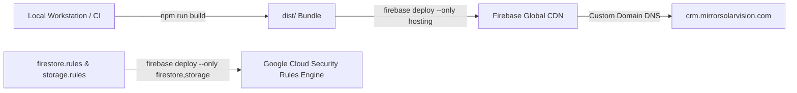

# Mirror Solar Vision CRM &mdash; Production Deployment Runbook

**Project Owner:** Mirror Solar Vision  
**Repository:** `mirrorsolarvision-ctrl/mirrorsolarcrm`  
**Target Domains:** [crm.mirrorsolarvision.com](https://crm.mirrorsolarvision.com) | [crm-webapp-d32bc.web.app](https://crm-webapp-d32bc.web.app)  
**Firebase Project:** `crm-webapp-d32bc`  
**Production Branch:** `main`  
**Deployment Authority:** ChatGPT & Antigravity Engineering  
**Version:** 3.0.0-PROD  
**Date:** November 3, 2026  

---

## 1. Production Architecture Overview

The CRM is deployed globally on Google Cloud via Firebase Hosting CDN with multi-region backend infrastructure:



---

## 2. Pre-Deployment Verification Checklist

Before deploying any release to production:

- [ ] **Working Tree Clean:** `git status` reports working tree clean.
- [ ] **Zero Exposed Credentials:** `git grep -i "password"` returns zero plaintext employee passwords or tokens.
- [ ] **Type Check & Build Pass:** `npm run build` (`tsc -b && vite build`) executes cleanly with zero errors.
- [ ] **Security Test Suite Pass:** `npm run test:security` reports 23 passed, 0 failed.
- [ ] **Disaster Recovery Suite Pass:** `npm run test:dr` confirms live database relational integrity.
- [ ] **Backup Executed:** Timestamped snapshot exported to `backups/`.

---

## 3. Step-by-Step Deployment Commands

### Step 3.1: Execute Pre-Flight Backup
```bash
npm run backup
```
*Exports a bit-for-bit JSON snapshot of all 7 core collections before releasing new code.*

### Step 3.2: Compile Production Bundle
```bash
npm run build
```
*Validates TypeScript interfaces and generates minified Rollup chunks in `dist/`.*

### Step 3.3: Deploy Firestore Security Rules
```bash
npx firebase-tools deploy --only firestore:rules --project crm-webapp-d32bc
```
*Releases kernel-level authorization, anti-forgery gates, and document separation.*

### Step 3.4: Deploy Storage Security Rules
```bash
npx firebase-tools deploy --only storage --project crm-webapp-d32bc
```
*Releases anti-IDOR path boundaries and payment receipts quarantine.*

### Step 3.5: Deploy Frontend Hosting Bundle
```bash
npx firebase-tools deploy --only hosting --project crm-webapp-d32bc
```
*Releases the web application to the global CDN.*

### Step 3.6: Automated Full Deployment Script
To execute all deployment steps automatically:
```cmd
scripts\deploy.bat
```

---

## 4. Post-Deployment Smoke Verification

Execute the following network and browser verification probes:

1. **HTTP Status & Cache Headers:**
   ```bash
   curl.exe -I https://crm.mirrorsolarvision.com
   ```
   *Expected Response:* `HTTP/2 200`, `Cache-Control: no-cache, no-store, must-revalidate`.
2. **Authentication Health Check:**
   - Verify unauthenticated users are directed to `/login`.
   - Verify fast-login chips are absent on production.
   - Verify active employee login with rotated individual credentials succeeds.
3. **Firestore Security Verification:**
   - Verify non-admin accounts cannot read `/leadFinancials` or write `PAYMENT_VERIFIED` audit logs.

---

## 5. Emergency Rollback Procedures

If a critical regression or security defect is detected post-deployment:

### A. Hosting Rollback
In the Firebase Console or via CLI:
```bash
npx firebase-tools hosting:rollback --project crm-webapp-d32bc
```
*Instantly restores the previous working hosting release within 5 seconds.*

### B. Rules Rollback
```bash
git checkout HEAD~1 firestore.rules storage.rules
npx firebase-tools deploy --only firestore:rules,storage --project crm-webapp-d32bc
```

### C. Database Disaster Recovery
```bash
node scripts/restoreVerification.mjs
```
*Restores data from the pre-flight backup snapshot in `backups/`.*
