# Mirror Solar Vision CRM &mdash; Master Development Roadmap (Phases 1.5 &ndash; 10)

**Project Owner:** Mirror Solar Vision  
**Repository:** `mirrorsolarvision-ctrl/mirrorsolarcrm`  
**Production URL:** [https://crm.mirrorsolarvision.com](https://crm.mirrorsolarvision.com)  
**Firebase Project:** `crm-webapp-d32bc`  
**Current Branch:** `main`  
**Architecture Authority:** ChatGPT & Antigravity Engineering  
**Version:** 3.0.0-PROD-ROADMAP  
**Date:** November 3, 2026  

---

## 1. Executive Phasing Overview

```mermaid
flowchart LR
    P15["Phase 1.5<br/>Security Acceptance<br/><b>[ACCEPTED]</b>"] --> P2["Phase 2<br/>Sales Automation<br/><b>[NEXT]</b>"]
    P2 --> P3["Phase 3<br/>Dealer Portal & Network<br/><b>[PLANNED]</b>"]
    P3 --> P4["Phase 4<br/>Solar Project Execution<br/><b>[PLANNED]</b>"]
    P4 --> P5["Phase 5<br/>Accounts & Financials<br/><b>[PLANNED]</b>"]
    P5 --> P6["Phase 6<br/>Inventory & Procurement<br/><b>[PLANNED]</b>"]
    P6 --> P7["Phase 7<br/>PM Surya Ghar Portal<br/><b>[PLANNED]</b>"]
    P7 --> P8["Phase 8<br/>Service & Warranty<br/><b>[PLANNED]</b>"]
    P8 --> P9["Phase 9<br/>AI Intelligence<br/><b>[PLANNED]</b>"]
    P9 --> P10["Phase 10<br/>Full Regression & Audit<br/><b>[FINAL]</b>"]
```

---

## 2. Phase-by-Phase Technical Specifications

### Phase 1.5 &mdash; Independent Security Acceptance & Backend Hardening
* **Status:** `ACCEPTED`
* **Features:**
  - Complete credential rotation (universal passwords removed and rejected by Firebase Auth).
  - Production login hardening: one-click instant login stripped from production builds.
  - Granular Firestore Security Rules: Lead scoping by `assignedEmployeeId`, payment verification gating (`isAdmin() || isAccounts()`), discount approval gating, dealer allocation approval restriction.
  - Audit log anti-forgery protection: Ordinary employees cannot forge sensitive financial or administrative actions.
  - Firebase Storage path isolation (anti-IDOR): KYC files and `/payments/` receipts bucket isolated.
  - Cross-device brute force protection in `/auth_attempts/{sanitizedEmail}` (15-min lockout upon 5 failures).
  - Disaster Recovery Suite: Automated cryptographic snapshot validation across 7 core collections in 1.20s.
* **Test Verification:** 23 / 23 Automated Security Tests Passed (`tests/security_and_rbac_audit.mjs`).

---

### Phase 2 &mdash; Complete Sales Automation & Communication Engine
* **Status:** `NOT STARTED` *(Recommended First Implementation Phase)*
* **Objective:** Transform the 12 sales modules into an automated, fault-tolerant lead-conversion pipeline.
* **Features & Capabilities:**
  1. **Automated Lead Distribution Engine:**
     - Round-robin and capacity-weighted lead allocation among active telecallers.
     - Working hours & leave-status aware routing (`employee.availabilityStatus === 'Active'`).
     - Auto-escalation: If a lead is not contacted within 15 minutes (SLA breach), auto-reassign to next telecaller or notify Sales Manager.
  2. **Telecalling Desk Hardening & Persistence:**
     - Full Firestore synchronization for `/call_leads/{callId}` (resolving `localStorage`-only limitation).
     - Single-click WebRTC / CTI click-to-dial deep links.
     - Call outcome state machines (auto-schedule follow-up on 'Busy' or 'No Answer'; auto-advance to 'Contacted' on 'Connected').
  3. **Official Meta WhatsApp Cloud API (WABA) Integration:**
     - Move from manual `wa.me` browser deep links to direct server-to-server messaging via Meta Cloud API.
     - Automated dispatch of Quotation PDFs, booking receipts, and survey appointments.
     - Inbound WhatsApp webhook listener to capture customer replies into the lead activity feed.
  4. **Sales Manager Leakage & Performance Analytics:**
     - 7 automated leakage alarms (uncontacted leads, overdue follow-ups, unquoted surveys, unverified bookings).
     - Daily call desk targets (35 calls/day) with live connect-rate leaderboard.
* **Database Collections:** `/leads`, `/call_leads`, `/ingested_events`, `/activities`.
* **Backend Functions:** `onLeadCreatedDistribution`, `checkSlaBreachCron`, `metaWebhookHandler`.
* **Acceptance Criteria:**
  - 100% of new leads automatically assigned to active telecallers within 5 seconds.
  - Call logs persist permanently to Firestore and reconcile across multiple client devices.
  - WhatsApp messages dispatched programmatically with verified delivery receipts.

---

### Phase 3 &mdash; Dealer Network & Regional Operations
* **Status:** `NOT STARTED`
* **Objective:** Expand dealer onboarding, commission governance, and site survey handoffs.
* **Features & Capabilities:**
  1. Dealer self-onboarding portal with multi-step KYC (GST, PAN, Trade License).
  2. Territory mapping & automatic site survey allocation based on customer pin code / district.
  3. Mobile-optimized Site Survey App for dealer field technicians (geo-tagged photos, roof dimensions, shadow analysis).
  4. Dealer Commission Ledger with automated commission calculation upon project commissioning (₹1,500 - ₹3,000/kW tiered).
* **Database Collections:** `/dealers`, `/dealer_surveys`, `/dealer_commissions`, `/dealer_stock`.
* **Acceptance Criteria:**
  - Dealers can only view and update leads allocated specifically to their dealer ID.
  - Field survey photos require client-side compression (<2MB) and GPS coordinates before upload.

---

### Phase 4 &mdash; Solar Project Management & Installation Execution
* **Status:** `NOT STARTED`
* **Objective:** Complete end-to-end solar engineering, procurement, and physical commissioning workflow.
* **Features & Capabilities:**
  1. 8-Stage Installation Milestone Tracker:
     - Feasibility Approval $\rightarrow$ Structure Fabrication $\rightarrow$ Module Mounting $\rightarrow$ Inverter Wiring $\rightarrow$ Earthing & Protection $\rightarrow$ DISCOM Net Metering $\rightarrow$ Plant Charging $\rightarrow$ Final Handover.
  2. Digital Job Card with milestone photographic proofs uploaded to Storage.
  3. Quality Assurance Checklist (earthing resistance $< 5\Omega$, VOC & ISC voltage verification).
  4. Customer Project Tracking Portal with live milestone progression view.
* **Database Collections:** `/projects`, `/project_milestones`, `/installation_checklists`.
* **Acceptance Criteria:**
  - Project cannot enter "Charging" stage without Net Metering agreement and inspection report.

---

### Phase 5 &mdash; Accounts & Financial Management (Segregation of Duties)
* **Status:** `NOT STARTED`
* **Objective:** Enterprise financial governance, customer billing, bank reconciliation, and payroll.
* **Features & Capabilities:**
  1. Accounts Verification Workbench: Dedicated interface for Accounts department to verify customer UTRs and bank deposits.
  2. GST-Compliant Tax Invoice Generation (CGST 6% + SGST 6% or IGST 12% on solar equipment; 18% on EPC services).
  3. Customer Payment Schedule Engine (Advance 10%, Feasibility 40%, Delivery 40%, Commissioning 10%).
  4. Employee Payroll Engine: Attendance-linked salary calculations, advances deduction, and pay slip PDF generator.
* **Database Collections:** `/invoices`, `/payments`, `/leadFinancials`, `/employee_salaries`, `/employee_payrolls`.
* **Acceptance Criteria:**
  - Invoices are cryptographically hashed and immutable once issued.
  - Zero possibility for sales or dealer personnel to mark payments as 'Verified'.

---

### Phase 6 &mdash; Inventory & Procurement Engine
* **Status:** `NOT STARTED`
* **Objective:** Real-time multi-warehouse inventory, serial-number tracking, and automated reorder points.
* **Features & Capabilities:**
  1. Central Warehouse vs Regional Dealer Stock isolation.
  2. Solar Panel & Inverter Individual Serial Number Tracking (barcode/QR code scanning).
  3. Bill of Materials (BOM) Auto-Deduction upon quotation project execution.
  4. Purchase Order generation with vendor price comparison.
* **Database Collections:** `/inventory`, `/stockRequests`, `/dealerStock`, `/stockDispatches`, `/materialConsumptions`.
* **Acceptance Criteria:**
  - Atomic Firestore transactions prevent negative stock during concurrent dispatches.

---

### Phase 7 &mdash; PM Surya Ghar National Portal & DISCOM Operations
* **Status:** `NOT STARTED`
* **Objective:** Government subsidy compliance and DISCOM application management.
* **Features & Capabilities:**
  1. PM Surya Ghar Application Document Hub (National Portal Application No., Consumer Number, Vendor Code).
  2. DISCOM Work Order & Feasibility tracking across APCPDCL, APEPDCL, TGSPDCL, TSNPDCL.
  3. Subsidy Claim Tracker: Tracking 3-tier central subsidy disbursements (₹30,000 / ₹60,000 / ₹78,000) directly into customer Aadhaar-linked accounts.
* **Database Collections:** `/leadKyc`, `/pmsgy_applications`, `/discom_work_orders`.
* **Acceptance Criteria:**
  - Complete document packet (Aadhaar, Electricity Bill, PCR, Net Metering Agreement) generated in 1-click.

---

### Phase 8 &mdash; Customer Service, Warranty & AMC Management
* **Status:** `NOT STARTED`
* **Objective:** Post-installation warranty management, generation monitoring, and ticketing.
* **Features & Capabilities:**
  1. Customer Service Ticket Desk with SLA priority queues.
  2. 25-Year Solar Panel Linear Warranty & 10-Year Inverter Warranty tracking.
  3. Annual Maintenance Contract (AMC) scheduling (periodic panel cleaning and inverter servicing).
* **Database Collections:** `/support_tickets`, `/warranty_records`, `/amc_contracts`.
* **Acceptance Criteria:**
  - Customer can register tickets via WhatsApp, tracking status via SMS or web link.

---

### Phase 9 &mdash; AI Business Intelligence & Predictive Analytics
* **Status:** `NOT STARTED`
* **Objective:** Executive dashboards, generation yield forecasting, and smart sales suggestions.
* **Features & Capabilities:**
  1. Rooftop Solar Yield Estimator with satellite solar irradiance calculations.
  2. Telecaller Smart Next-Action Recommender (best time to call, conversion probability score).
  3. Financial & Revenue Forecasting with real-time gross margin projections.
* **Database Collections:** `/analytics_snapshots`, `/ai_insights`.

---

### Phase 10 &mdash; Full System Regression, Production Acceptance & Sign-off
* **Status:** `NOT STARTED`
* **Objective:** Final end-to-end stress testing, disaster recovery rehearsal, and production handoff.
* **Features & Capabilities:**
  1. 100% automated test coverage across unit, integration, and security suites.
  2. Multi-region DR drill with zero data loss ($RPO = 0$, $RTO < 15\text{ mins}$).
  3. Security vulnerability penetration test by independent auditor.
  4. Production handover documentation and administrative runbooks.

