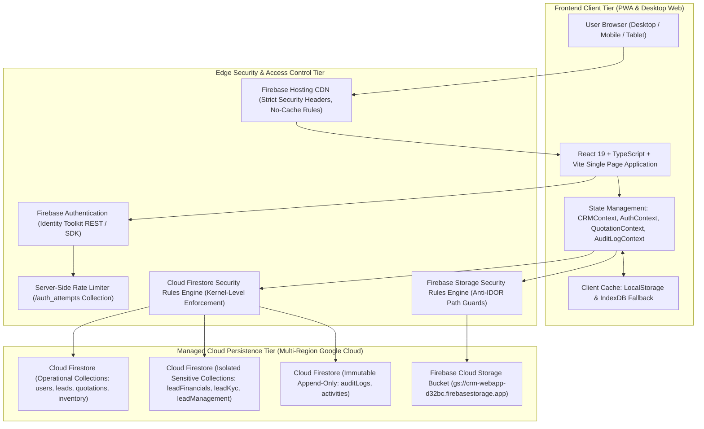
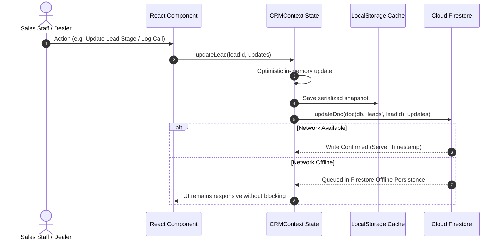

# Mirror Solar Vision CRM &mdash; System Architecture Specification

**Project Owner:** Mirror Solar Vision  
**Repository:** `mirrorsolarvision-ctrl/mirrorsolarcrm`  
**Production URL:** [https://crm.mirrorsolarvision.com](https://crm.mirrorsolarvision.com)  
**Firebase Project:** `crm-webapp-d32bc`  
**Architecture Authority:** ChatGPT & Antigravity Engineering  
**Version:** 3.0.0-PROD  
**Date:** November 3, 2026  

---

## 1. High-Level Architecture Diagram



---

## 2. Technology Stack & Runtime Specifications

| Tier | Component | Technology / Version | Justification & Architectural Role |
|---|---|---|---|
| **Frontend Framework** | UI Core | React `19.2.8` | Declarative UI, Concurrent Mode, Transitions, and zero runtime overhead |
| **Language** | Type Safety | TypeScript `6.0.2` | Compile-time validation of financial models, lead scoring, and roles |
| **Bundler & Build** | Fast Dev / Prod Build | Vite `8.2.0` | Sub-second HMR, tree-shaking, Rollup-based asset optimization |
| **Routing** | Client Routing | React Router `7.18.2` | Single Page Application client routing with authentication guards |
| **Icons** | Design System | Lucide React `1.31.0` | Comprehensive accessible SVG icon library |
| **Data Export** | Spreadsheet Engine | XLSX `0.18.5` | Client-side Excel lead export and bulk import parsing |
| **Database** | NoSQL Cloud Database | Google Cloud Firestore | Real-time multi-region NoSQL persistence with security rules engine |
| **Authentication** | IAM & Security | Firebase Authentication `12.18.0` | Email/Password, secure session management, token issuance |
| **Object Storage** | Blob Storage | Firebase Cloud Storage | Storage for customer KYC documents, site survey photos, and invoices |
| **Static Hosting** | Edge Hosting | Firebase Hosting | Global CDN with customized HTTP security headers and cache invalidation |

---

## 3. Frontend Architecture & Modular Organization

The frontend codebase is partitioned cleanly into role-based workspaces and shared utility engines:

```
src/
├── assets/                  # Branding assets, company logos, static media
├── components/              # Shared modals and enterprise widgets
│   ├── DocumentUploadModal.tsx       # File upload with progress bars & mime validation
│   ├── QuotationEditor.tsx           # Advanced financial quotation builder with line items
│   ├── SolarRoiCalculatorModal.tsx   # Solar savings & payback estimation modal
│   ├── UnifiedRecordPaymentModal.tsx # Advance and milestone payment recording modal
│   ├── WhatsAppBuddy.tsx             # Moveable & hideable floating WhatsApp quick-launch
│   └── MobileBottomNav.tsx           # Mobile-optimized bottom navigation drawer
├── config/                  # Business configuration rules
│   └── subsidyRules.ts               # PM Surya Ghar 2024 national subsidy calculation matrix
├── context/                 # Context providers managing enterprise state
│   ├── AuthContext.tsx               # Firebase session state, login, and lockout enforcement
│   ├── CRMContext.tsx                # Master state for leads, employees, dealers, and inventory
│   ├── QuotationContext.tsx          # Advanced quotation v2 engine with versioning and BOM
│   ├── AuditLogContext.tsx           # Append-only immutable audit logging engine
│   └── AttendanceContext.tsx         # GPS-verified employee shift check-in and timesheets
├── dealer/                  # Authorized Regional Dealer Workspace
│   ├── DealerApp.tsx                 # Dealer navigation shell and route manager
│   ├── DealerDashboard.tsx           # Territory sales, lead pipeline, and commission overview
│   ├── DealerLeadsPage.tsx           # Allocated leads view (scoped to dealer ID)
│   ├── DealerQuotationsPage.tsx      # Quotation generation for territory customers
│   └── DealerStockPage.tsx           # Regional warehouse buffer stock and dispatch acceptance
├── employee/                # Staff & Telecaller Workspace
│   ├── EmployeeApp.tsx               # Employee shell with category-aware navigation
│   ├── EmployeeDashboard.tsx         # Personal KPI metrics, daily targets, and tasks
│   ├── EmployeeLeadsPage.tsx         # Assigned leads only (scoped by employee ID)
│   └── EmployeeAttendancePage.tsx    # Shift punch in/out with geolocation validation
├── pages/                   # Admin & Super-User Portals
│   ├── AdminDashboard.tsx            # Executive master dashboard with leakage alarms
│   ├── AdminEmployeesPage.tsx        # Employee directory, roles, and credential management
│   ├── AdminDealersPage.tsx          # Regional dealer onboarding and commission rates
│   ├── AdminPayrollPage.tsx          # Monthly payroll, advance deductions, and payslips
│   ├── AdminAuditLogsPage.tsx        # Security audit trail review (filter by actor & action)
│   ├── CallLeadsPage.tsx             # Centralized telecalling desk
│   └── QuotationsPortalPage.tsx      # Central quotation amendment and locking register
├── sales/                   # 12-Module Enterprise Sales Workspace
│   ├── SalesWorkspace.tsx            # Sales navigation hub with dynamic badge counters
│   └── views/                        # 12 Integrated Sales Sub-Views
│       ├── SalesDashboardView.tsx        # Sales funnel, conversion metrics, leakage monitors
│       ├── SalesLeadsView.tsx            # Deduplicated lead directory with search & filters
│       ├── TelecallingCentreView.tsx     # 35-call daily calling desk and outcome logging
│       ├── CustomerQualificationView.tsx # 4-pillar qualification and live score computation
│       ├── SalesPipelineView.tsx         # 12-stage visual pipeline with transition gates
│       ├── SalesFollowupsView.tsx        # Overdue, today, and upcoming scheduled follow-ups
│       ├── WhatsAppCentreView.tsx        # 6 pre-approved WhatsApp templates and dispatch
│       ├── SalesQuotationsView.tsx       # Standard system sizing and discount request
│       ├── SalesBookingsView.tsx         # Customer advance token recording & accounts gate
│       ├── SalesDealerCoordinationView.tsx # Site survey scheduling with regional dealers
│       ├── CustomerDocumentsView.tsx     # Project KYC checklist and verification status
│       ├── SalesReportsView.tsx          # Lead source attribution and team conversion analytics
│       └── SalesTeamPerformanceView.tsx  # Telecaller leaderboard, connect rates, and awards
├── types/                   # TypeScript interfaces and domain models
│   ├── sales.ts                      # Sales department models, qualification, and call logs
│   ├── quotation.ts                  # Quotation v2 line-items, tax matrix, and version snapshots
│   └── payroll.ts                    # Salary structures, bank details, and advance records
└── utils/                   # Pure business logic and calculation algorithms
    ├── salesCalculations.ts          # Lead score algorithm, phone normalization, duplicate checks
    ├── quotationCalculations.ts      # Multi-tax line-item calculations and margin derivation
    ├── permissionCalculations.ts     # Role-based visibility and capability predicates
    └── employeeCalculations.ts       # Attendance timesheet hours and commission totals
```

---

## 4. Security Rules Architecture

### A. Cloud Firestore Rules Engine (`firestore.rules`)
Firestore enforces authorization at the database kernel level, entirely independent of the frontend code:

1. **Scoped Data Isolation:**
   - Telecalling employees are restricted to reading leads where `assignedEmployeeId == request.auth.uid`.
   - Authorized dealers can only read leads where `dealerId == request.auth.uid` or matching their `dealerCode`.
   - Super Admin and Accounts have global visibility for operational audits.
2. **Segregation of Duties (Financial Gates):**
   - Non-privileged staff attempting to set `paymentVerificationStatus: 'Verified'` are rejected with `PERMISSION_DENIED`. Only `isAdmin()` or `isAccounts()` can verify payments.
   - Non-admins attempting to approve discounts (`discountApprovalStatus: 'Approved'`) are rejected.
3. **Audit Log Anti-Forgery Shield:**
   - Audit logs are append-only (`update, delete: if false`).
   - Creation of sensitive action logs (`PAYMENT_VERIFIED`, `ROLE_CHANGED`, `DISCOUNT_APPROVED`) by non-privileged accounts is blocked at the database level.
4. **Document Separation Architecture:**
   - High-sensitivity data is segregated into distinct top-level collections:
     - `/leadFinancials/{leadId}`: Restricted to Admin & Accounts.
     - `/leadKyc/{leadId}`: Restricted to Admin & PM Surya Ghar Incharge.
     - `/leadManagement/{leadId}`: Restricted to Admin & Sales Manager.
5. **Cross-Device Brute-Force Rate Limiting:**
   - Client authentication failures increment `/auth_attempts/{sanitizedEmail}`. Upon 5 consecutive failures, the account is locked server-side for 15 minutes across all devices and sessions.

### B. Firebase Cloud Storage Rules (`storage.rules`)
1. **Path-Based IDOR Protection:**
   - Customer KYC documents (`/leads/{leadId}/documents/...`) are restricted to verified internal email domains (`@mirrorsolar.in`, `@dealer.in`, `@msv.in`). External tokens guessing paths are rejected.
2. **Payment Receipt Quarantine:**
   - Global payment receipts (`/payments/{category}/...`) can only be read by `isAdmin()` or `isAccounts()`.
3. **Immutability of Audit & Financial Evidence:**
   - Once a receipt or document is uploaded, updates and deletes are disabled (`update, delete: if false`).

---

## 5. Offline Caching & Resilient State Synchronization



---

## 6. Edge Security Headers & Cache Configuration (`firebase.json`)

To prevent clickjacking, MIME-sniffing, XSS, and stale client bundle execution:
- `X-Frame-Options: SAMEORIGIN`
- `X-Content-Type-Options: nosniff`
- `X-XSS-Protection: 1; mode=block`
- `Referrer-Policy: strict-origin-when-cross-origin`
- `Strict-Transport-Security: max-age=31536000; includeSubDomains`
- `/index.html` and `/version.json` headers: `Cache-Control: no-cache, no-store, must-revalidate`

