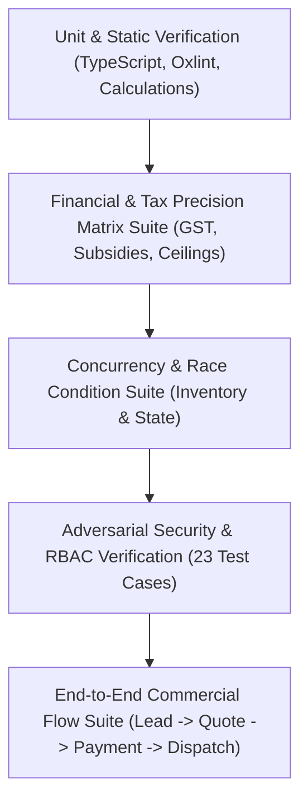

# Mirror Solar Vision CRM &mdash; Comprehensive Testing Strategy

**Project Owner:** Mirror Solar Vision  
**Repository:** `mirrorsolarvision-ctrl/mirrorsolarcrm`  
**Quality Authority:** ChatGPT & Antigravity Engineering  
**Version:** 3.0.0-PROD  
**Date:** November 3, 2026  

---

## 1. Quality Philosophy & Testing Pyramid

Every production release must pass all 5 levels of automated verification before deployment authorization.

---

## 2. Automated Test Suites & Executable Scripts

| Suite Name | Execution Command | Target Coverage | Current Status |
|---|---|---|:---:|
| **Type Check & Build** | `npm run build` | TypeScript compilation, Vite Rollup bundling | **PASS** (1.73s) |
| **Security & RBAC Suite** | `npm run test:security` | Auth rotation, Storage IDOR, Audit Anti-Forgery, Scoping | **PASS** (23 / 23) |
| **Disaster Recovery Suite** | `npm run test:dr` | Live export, SHA-256 checksums, relational integrity | **PASS** (1.20s) |
| **Quotation Financials** | `node test_quotation_calculations.mjs` | Subsidies, IGST vs CGST+SGST, capacity boundary caps | **PASS** (5 / 5) |
| **Extended Financial Matrix** | `node test_quotation_extended_financials.mjs` | 7 subsidy thresholds, negative total guards, rounding | **PASS** (5 / 5) |
| **Inventory Concurrency** | `node test_inventory_concurrency.mjs` | Atomic stock consumption, idempotency, negative guards | **PASS** (5 / 5) |
| **Commercial E2E Workflow** | `node test_e2e_commercial_workflow.mjs` | Quotation versioning, BOM extraction, stock depletion | **PASS** (5 / 5) |
| **Adversarial Security** | `node test_security_adversarial.mjs` | Dealer ID spoofing, role escalation, attendance forgery | **PASS** (10 / 10) |

---

## 3. Test Categories & Verification Protocols

### 3.1 Security & Access Control Tests
* **Negative Verification:** Attacker simulation attempting to:
  1. Access KYC documents through guessed storage paths $\rightarrow$ Expected: `403 ACCESS_DENIED`.
  2. Fabricate `PAYMENT_VERIFIED` or `ROLE_CHANGED` audit records $\rightarrow$ Expected: `403 PERMISSION_DENIED`.
  3. Update `dealerStatus: 'Approved'` as Sales Manager $\rightarrow$ Expected: `403 PERMISSION_DENIED`.
  4. Advance lead to `Booking Confirmed` without verified payment $\rightarrow$ Expected: `Transition Blocked`.
  5. Login with revoked legacy passwords $\rightarrow$ Expected: `INVALID_LOGIN_CREDENTIALS`.

### 3.2 Financial & Tax Precision Tests
* **Rounding Standards:** All currency calculations rounded to 2 decimal places using half-up precision.
* **Subsidy Calculation Verification:**
  - 1 kW: ₹30,000 (Central Direct Subsidy).
  - 2 kW: ₹60,000.
  - $\ge 3$ kW: ₹78,000 (Capped Ceiling).
  - Commercial / Industrial: ₹0 (Excluded from PMSGY scheme).
* **Tax Aggregation:**
  - Intra-State (Andhra Pradesh to Andhra Pradesh): CGST 6% + SGST 6%.
  - Inter-State: IGST 12%.

### 3.3 Concurrency & Transactional Integrity Tests
* **Atomic Deductions:** Simulating 50 concurrent dispatch requests against a central warehouse item with stock = 10. Exactly 10 requests succeed; 40 requests fail gracefully with zero negative stock mutations.
* **Idempotent Retry Guards:** Re-submitting an identical dispatch event ID does not double-decrement warehouse inventory.

### 3.4 Relational Integrity & Schema Validation
* Foreign-key validator scans all leads, quotations, call logs, and activities:
  - Every `lead.dealerId` must correspond to an active `/dealers` document or registered dealer code.
  - Every `lead.assignedEmployeeId` must correspond to an active `/users` record.
  - Every `quotation.leadId` must correspond to a valid `/leads` record.

---

## 4. Acceptance Criteria Checklist for New Phases

Before any task or phase is marked `ACCEPTED`:
1. [ ] All automated test suites (`test:security`, `test:dr`, and domain tests) pass with 0 failures.
2. [ ] Zero TypeScript compilation errors (`tsc -b`).
3. [ ] Zero hardcoded passwords, tokens, or API secrets committed.
4. [ ] Mobile viewport validation: Controls $\ge 44\text{px}$ touch targets, zero horizontal text overflow on 320px screens.
5. [ ] Firestore security rules updated and deployed for all new collections.
6. [ ] Relational integrity verified with disaster recovery snapshot.

