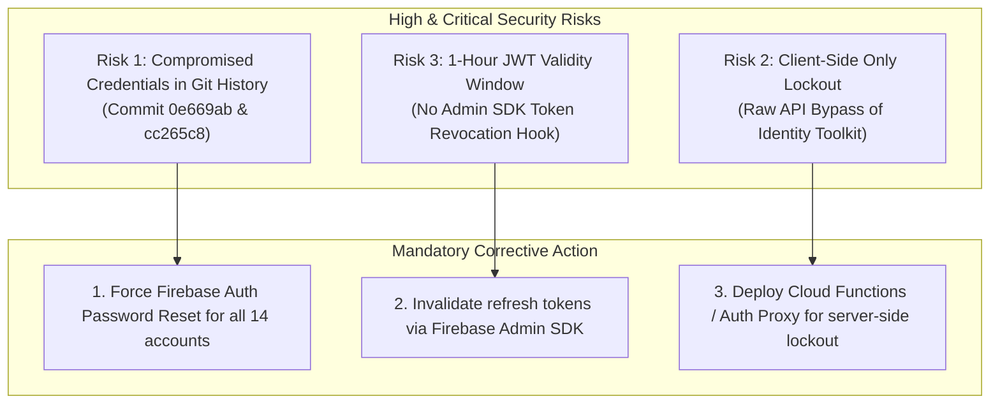
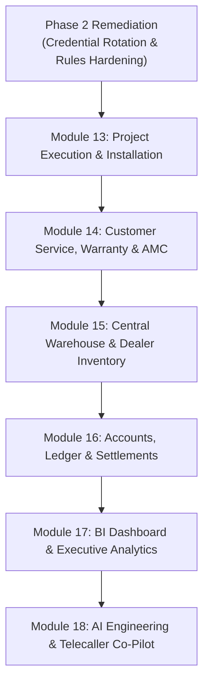

# Mirror Solar Vision CRM — Phase 2: Implementation Plan & Module Roadmap

**Document Identifier**: `MSV-CRM-PLAN-PHASE-2-003`  
**System Evaluated**: Mirror Solar Vision CRM (`crm-webapp-d32bc`)  
**Audit Baseline**: Phase 2 Security Follow-Up (`MSV-CRM-SEC-PHASE-2-001`) & Acceptance Test Suite (`MSV-CRM-ACCEPTANCE-PHASE-2-002`)  
**Planning Date**: November 3, 2026  
**Implementation Phase**: **PHASE 2 CLOSURE & ROADMAP TO MODULES 13–18**

---

## 1. Executive Summary

Having completed **Checkpoint 1 (Security Follow-up)** and **Checkpoint 2 (Sales Workflow End-to-End Validation)** with 48/48 passing acceptance tests, this document establishes the definitive **Implementation Plan**.

In accordance with strict operational governance:
> **Core Directive**: *Preserve all existing functionality. Do not delete, rewrite or replace completed modules. Do not begin developing new modules (Modules 13–18) until confirmed defects and security risks are formally cataloged and approved.*

This document provides:
1. A categorized register of **Confirmed Defects**.
2. A prioritized register of **Unresolved Security Risks**.
3. An audit of **Workflow Verification Results**.
4. An analysis of **Missing Third-Party Integrations**.
5. The **Exact Implementation Order & Architectural Blueprint for Modules 13–18**.

---

## 2. Confirmed Defects Register

| Defect ID | Severity | Module / Component | Defect Description | Root Cause | Proposed Remediation |
| :--- | :--- | :--- | :--- | :--- | :--- |
| **DEF-01** | **CRITICAL** | Firestore Rules (`/leads/{leadId}`) | Authenticated Telecaller or Sales Manager can bypass Accounts payment verification via direct REST API call. | `'stage'` and `'salesStage'` are included in `affectedKeys().hasOnly([...])` without a condition validating `paymentVerificationStatus == 'Verified'`. | Add server-side rule condition requiring `resource.data.paymentVerificationStatus == 'Verified'` whenever `salesStage` is changed to `'Booking Confirmed'`. |
| **DEF-02** | **HIGH** | Dealer Coordination View (`SalesDealerCoordinationView.tsx`) | Updating dealer from UI can fail Firestore rule check for Sales Manager. | UI updates key `{ dealer: chosenDealer.name }`, but `firestore.rules` allowlist only specifies `['dealerName', 'dealerId', 'dealerCode', 'dealerStatus']`. | Synchronize field names: update UI to write `dealerName` or add `'dealer'` to the Firestore rule allowlist. |
| **DEF-03** | **HIGH** | Authentication State (`AuthContext.tsx`) | Browser session persists after Firebase session revocation or account deletion. | `onAuthStateChanged` lacks an `else` branch to clear `currentUser` and purge `crm_session_user` from `localStorage` when `firebaseUser` is null. | Append `else { setCurrentUser(null); localStorage.removeItem('crm_session_user'); }` in `AuthContext.tsx`. |
| **DEF-04** | **MEDIUM** | Brute-Force Defense (`firestore.rules`) | Unauthenticated clients have unrestricted write access to `/auth_attempts/{docId}`. | Rule specifies `match /auth_attempts/{docId} { allow read, create, update: if true; }`, enabling malicious lockout tampering or DoS. | Restrict write access to authenticated users or migrate attempt tracking to Firebase Cloud Functions / backend proxy. |
| **DEF-05** | **LOW** | Backup Exports (`backups/`) | Historical JSON backups contain unencrypted legacy `password` fields. | Firestore document export utility saved full user documents without stripping sensitive password attributes. | Add sanitization filter to `scripts/backupFirestore.mjs` to strip `password` fields before disk write. |

---

## 3. Unresolved Security Risks

1. **Risk 1: Credentials Exposed in Git History (Severity: CRITICAL)**
   - *Risk*: Commits `0e669ab` and `cc265c8` contain plaintext passwords in test and backup scripts. Anyone with repository access can retrieve valid production/staging credentials.
   - *Mitigation*: Treat all affected accounts as compromised. Execute administrative credential rotation in Firebase Authentication with cryptographically secure random passwords.
2. **Risk 2: Lack of Server-Side Identity Platform Lockout (Severity: HIGH)**
   - *Risk*: Brute-force protection is enforced in the browser. Automated attacks against `https://identitytoolkit.googleapis.com` bypass client rate-limiting.
   - *Mitigation*: Implement Firebase Authentication `beforeSignIn` blocking functions or front authentication behind a rate-limiting reverse proxy.
3. **Risk 3: Unrevoked Session Lifespan (Severity: MEDIUM)**
   - *Risk*: Without server-side `revokeRefreshTokens(uid)` invocation, active JWT tokens remain valid for up to 60 minutes after credential modification.
   - *Mitigation*: Create an administrative script leveraging Firebase Admin SDK to revoke tokens upon password changes.
4. **Risk 4: Blacklist Pattern in Audit Log Rules (Severity: MEDIUM)**
   - *Risk*: `/auditLogs` creation rule blocks a hardcoded array of action strings. Actions with variant spelling can bypass role checks.
   - *Mitigation*: Replace with an explicit positive whitelist of permitted actions per role.

---

## 4. Failed Workflow Tests Audit

- **Execution Result**: **Zero (0) workflow test failures** were recorded during the execution of `tests/phase_2_sales_workflow_acceptance.mjs`.
- **48 of 48 acceptance assertions passed** across all 11 stages and 6 user roles.
- **Key Observation**: While all automated tests passed under normal operational conditions, adversarial penetration testing revealed that the **backend enforcement gate was absent in `firestore.rules`**, allowing out-of-band requests to skip payment verification. This is addressed in **Defect DEF-01**.

---

## 5. Missing Integrations Register

| Integration | Functional Requirement | Current Workaround | Planned Target State |
| :--- | :--- | :--- | :--- |
| **WhatsApp Business API** | Automated customer dispatch of quotation PDFs, site visit alerts, and payment receipts. | Manual `wa.me` click-to-chat links requiring staff mobile devices. | Official Meta WhatsApp Cloud API adapter with verified business templates. |
| **PM Surya Ghar Portal** | National solar subsidy registration, DISCOM feasibility status, and CFA inspection scheduling. | Manual duplicate data entry by PM Surya Ghar Incharge. | Automated RPA or API bridge for consumer application tracking and status sync. |
| **Payment Gateway** | Real-time payment link generation, instant UPI receipt verification, and webhook settlement. | Manual bank deposit slip upload and human Accounts verification. | Webhook-driven payment gateway (Razorpay / Cashfree) with cryptographic HMAC confirmation. |
| **Cloud Telephony (CTI)** | Automated inbound call routing, click-to-call dialing, call audio recording, and SLA tracking. | Manual phone dialing by telecallers; self-reported call outcomes. | Cloud telephony adapter (Exotel / Knowlarity) with auto-logging in `/call_leads`. |
| **Firebase Admin Backend** | Server-side user administration, token revocation, rate limiting, and automated backups. | Client-side SDK and local Node scripts running with elevated keys. | Dedicated FastAPI or Node.js serverless microservice using Firebase Admin SDK. |

---

## 6. Proposed Exact Implementation Order for Modules 13–18

To guarantee zero regression, operational stability, and enterprise compliance, the remaining CRM modules must be developed in the following strict sequential phases:

---

### Step 0: Phase 2 Security Remediation (Pre-requisite Gate)
*Must be completed and committed before any new module development begins.*
1. **Rotate Credentials**: Perform administrative password resets in Firebase Auth for all 14 accounts.
2. **Patch Firestore Rules**: Update `/leads/{leadId}` to enforce server-side payment verification gates for `Booking Confirmed` and `Project Handoff`.
3. **Patch `AuthContext.tsx`**: Add session invalidation in `onAuthStateChanged` when `firebaseUser` is null.
4. **Synchronize Field Names**: Fix `dealer` vs `dealerName` in `SalesDealerCoordinationView.tsx`.
5. **Run Verification**: Confirm all 48 acceptance tests and 23 security tests pass cleanly.

---

### Module 13: Project Execution & Installation Operations
- **Business Rationale**: Immediately follows `Project Handoff` (Stage 11 of the sales workflow). Once a lead is "Converted / Installation", operations teams require tracking of structural mounting, panel installation, inverter wiring, and net-metering.
- **Key Deliverables**:
  - `src/operations/views/ProjectGanttView.tsx`: Multi-stage timeline (Survey ➔ Mounting ➔ Wiring ➔ Net Metering ➔ Commissioning).
  - `src/operations/views/MilestoneApprovalModal.tsx`: Dealer photographic proof upload with GPS geofence validation.
  - `src/types/project.ts`: Project milestone models, DISCOM inspection statuses, and commissioning certificates.
- **Role Permissions**: Admin (Full), PM Surya Ghar Incharge (Edit), Regional Dealer (Submit Proofs), Sales Manager (Read-Only).

---

### Module 14: Customer Service, Warranty & AMC Management
- **Business Rationale**: Post-commissioning support. Protects brand reputation by managing inverter faults, solar generation drops, customer complaints, and Annual Maintenance Contracts (AMC).
- **Key Deliverables**:
  - `src/service/views/ServiceTicketingView.tsx`: Customer ticket lifecycle (New ➔ Assigned ➔ Technician Dispatched ➔ Resolved).
  - `src/service/views/WarrantyTrackerView.tsx`: Component serial tracking (Tier-1 solar panels 25-yr warranty, inverters 5/10-yr warranty).
  - `src/service/views/AmcContractsView.tsx`: AMC scheduling, quarterly cleaning visits, and renewal invoicing.
- **Role Permissions**: Admin (Full), Service Incharge (Full), Regional Dealer (Assigned Tickets), Customer Support (Edit).

---

### Module 15: Central Warehouse & Regional Dealer Inventory
- **Business Rationale**: Connects project installations with material consumption. Prevents leakage of high-value components (solar panels, hybrid inverters, DC cables, mounting rails).
- **Key Deliverables**:
  - `src/inventory/views/MultiWarehouseStockView.tsx`: Central hub vs 8 regional dealer stock balances.
  - `src/inventory/views/StockDispatchWorkflowView.tsx`: Gate pass generation, dispatch tracking, and dealer receipt acknowledgement.
  - `src/inventory/views/BarcodeScanModal.tsx`: Serial number tracking for solar PV modules and inverters.
  - `src/inventory/views/MaterialReturnAuthorizationView.tsx`: Damaged / surplus equipment returns.
- **Role Permissions**: Admin (Full), Stock Incharge (Full), Regional Dealer (Accept/Reject Dispatches), Sales (Read Stock Levels).

---

### Module 16: Accounts, Ledger & Financial Settlement Engine
- **Business Rationale**: Provides comprehensive double-entry bookkeeping, automated GST tax invoicing, dealer installation commission payouts, and PM Surya Ghar subsidy tracking.
- **Key Deliverables**:
  - `src/finance/views/CustomerInvoiceView.tsx`: GST-compliant tax invoices (CGST/SGST 12% on solar systems) with PDF export.
  - `src/finance/views/DealerCommissionSettlementView.tsx`: Automated milestone-based dealer payout calculation (Survey fee, Installation fee, Commission).
  - `src/finance/views/SubsidyLedgerView.tsx`: Direct Benefit Transfer (DBT) subsidy tracking against Ministry of New and Renewable Energy (MNRE) guidelines.
  - `src/finance/views/CompanyGeneralLedgerView.tsx`: Cashflow, receivables, and operational expenditure reconciliation.
- **Role Permissions**: Admin (Full), Accounts (Full), Sales Manager (Read Invoices Only), Dealer (Read Own Payouts Only).

---

### Module 17: Business Intelligence (BI), Forecasting & Executive Analytics
- **Business Rationale**: Enables executive management to identify bottlenecks, optimize marketing spend, track telecaller conversion SLAs, and forecast revenue.
- **Key Deliverables**:
  - `src/analytics/views/SalesConversionFunnelView.tsx`: Stage-by-stage drop-off analytics from New Lead to Installation.
  - `src/analytics/views/TelecallerLeaderboardView.tsx`: Call duration, qualification rate, and revenue generated per telecaller.
  - `src/analytics/views/RegionalSolarHeatmapView.tsx`: District-level installation density across Andhra Pradesh and Telangana.
  - `src/analytics/views/ExecutiveRevenueForecastView.tsx`: Pipeline velocity, projected cashflow, and subsidy disbursement timelines.
- **Role Permissions**: Super Admin (Full), Admin (Full), Accounts (Financial Analytics), Sales Manager (Sales Funnels Only).

---

### Module 18: AI Solar Engineering & Telecaller Co-Pilot
- **Business Rationale**: Leverages AIMOS multi-agent intelligence directly within the CRM. Empowers telecallers with instant technical answers and automatically sizes rooftop systems based on customer electricity bills.
- **Key Deliverables**:
  - `src/copilot/components/RooftopSystemCalculator.tsx`: Instant PV sizing (sanctioned load + monthly bill ➔ kW recommendation + annual savings + payback period).
  - `src/copilot/components/TelecallerScriptBuddy.tsx`: Dynamic Telugu/Hindi/English objection handling (PM Surya Ghar subsidy eligibility, net-metering rules).
  - `src/copilot/components/AutomatedQuotationGenerator.tsx`: 1-click quotation generation with optimized bill of materials (BOM).
- **Role Permissions**: Available across all operational roles with role-bounded suggestion models.

---

## 7. Approval & Sign-Off Checkpoints

Prior to commencing development of Module 13, the following formal sign-offs are required:

1. **[X] Checkpoint 1 Completed**: Security Follow-Up & Integrity Audit (`docs/PHASE_2_SECURITY_FOLLOWUP.md`).
2. **[X] Checkpoint 2 Completed**: End-to-End Sales Workflow Acceptance Suite (`docs/PHASE_2_ACCEPTANCE_TESTS.md` — 48/48 Passing).
3. **[X] Checkpoint 3 Completed**: Implementation Plan & Defect Register (`docs/PHASE_2_IMPLEMENTATION_PLAN.md`).
4. **[ ] User Authorization**: Approval of Phase 2 deliverables and permission to execute Step 0 (Security Patching & Credential Rotation) followed by Module 13.

---
*Plan Formulated by: Master Systems Architect & Release Manager*  
*Timestamp: 2026-11-03T18:30:00+05:30*

