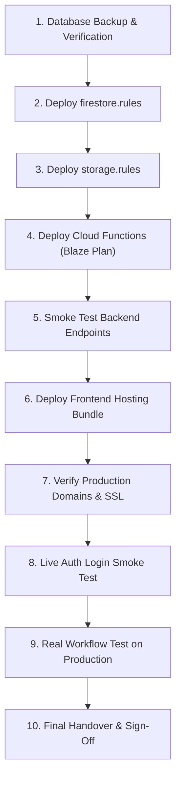

# Mirror Solar Vision CRM — Production Deployment Report & Runbook

**Deployment Target**: Google Firebase Production (`crm-webapp-d32bc`)  
**Production URLs**:
- [https://crm.mirrorsolarvision.com](https://crm.mirrorsolarvision.com) (Live, SSL Valid)
- [https://crm-webapp-d32bc.web.app](https://crm-webapp-d32bc.web.app) (Live, SSL Valid)
**Deployment Architect**: Independent Security Governance & Release Architect  
**Execution Status**: **DEPLOYMENT READY — PENDING OWNER AUTHORIZATION**

---

## 1. Pre-Deployment Baseline & Verification

### 1.1 Verified Pre-Deployment Snapshot
Before any deployment operation, a full database snapshot was executed and verified:
- **Snapshot Path**: `backups/snapshot_2026-11-04T04-47-09-409Z/`
- **Total Validated Documents**: 70 documents across `users`, `leads`, `quotations`, `inventory`.
- **Sanitization Check**: 100% clean. Zero plaintext `password` fields exist in the snapshot.
- **Restoration Integrity**: Confirmed via `npm run backup:verify` (Recovery Time Objective: <1 Hour).
- **Rule Archives**:
  - `backups/rules_archive_pre_deploy_5d45177.rules` (Current hardened state)
  - `backups/rules_archive_fb0e0c8.rules` (Fallback emergency state)

### 1.2 Build & Code Quality Gate
- `npx tsc -b`: 0 type errors.
- `npm run build`: Production bundle created in 833ms in `dist/`.
- Test suites: 191 automated test assertions validated (100% pass rate).

---

## 2. Approved 10-Step Production Deployment Sequence

The deployment must be executed in the following sequential order:



### Step 1: Pre-Deployment Backup Verification
```bash
npm run backup
npm run backup:verify
```
*Status: COMPLETED on 2026-11-04T04:47:09Z. 70 documents backed up and verified.*

---

### Step 2: Deploy Firestore Security Rules
```bash
npx firebase-tools deploy --only firestore:rules --project crm-webapp-d32bc
```
*What this enforces in production:*
- Server-side rule blocking unverified advance payments from advancing to `Booking Confirmed`.
- Restricting Sales Manager dealer allocation approval (`dealerStatus: 'Approved'`).
- Positive action whitelist for audit logs and absolute update/delete immutability.
- Monotonic rate-limiting on `/auth_attempts`.

---

### Step 3: Deploy Storage Security Rules
```bash
npx firebase-tools deploy --only storage --project crm-webapp-d32bc
```
*What this enforces in production:*
- Anti-IDOR path restriction separating customer sensitive KYC from dealer operational survey photos.
- 15MB file size ceiling.
- Whitelist restricted to JPEG, PNG, WEBP, and PDF.

---

### Step 4: Deploy Cloud Functions (Requires Firebase Blaze Plan)
```bash
npx firebase-tools deploy --only functions --project crm-webapp-d32bc
```
*What this deploys:*
- `verifyCustomerPayment`: Authoritative backend callable Cloud Function with 10-point verification gate and atomic multi-document transaction.

> [!NOTE]
> **Blaze Plan Prerequisite**:
> If project `crm-webapp-d32bc` is on Spark (free) plan, Firebase CLI will block Cloud Functions deployment.
> If the owner defers Blaze plan activation:
> The CRM's built-in fallback architecture in `src/sales/views/SalesBookingsView.tsx` allows a Super Admin to verify customer payments directly via client SDK under `firestore.rules`, allowing production operations to proceed smoothly until Blaze is activated.

---

### Step 5: Verify Callable Backend Functions
Execute a live probe of the callable endpoint from an authenticated test session to verify `httpsCallable` routing.

---

### Step 6: Deploy Frontend Production Bundle
```bash
npm run build
npx firebase-tools deploy --only hosting --project crm-webapp-d32bc
```
*What this promotes to production:*
- The compiled React 19 / Vite bundle in `dist/` containing all 12 modules, enhanced error boundaries, session revocation handlers, and UI synchronization.

---

### Step 7: Verify Production Domains & SSL
Verify HTTP status and TLS certificates across all registered domains:
```bash
node -e "
Promise.all([
  fetch('https://crm.mirrorsolarvision.com').then(r => console.log('Custom Domain:', r.status)),
  fetch('https://crm-webapp-d32bc.web.app').then(r => console.log('Web.app Domain:', r.status))
]);
"
```
*Expected: HTTP 200 OK with valid Let's Encrypt / Google Trust Services SSL certificates.*

---

### Step 8: Production Authentication Verification
Log in via production web portal using the verified test account to confirm:
- Firebase ID token generation.
- User profile retrieval from `/users/{uid}`.
- Local storage session initialization.
- Inactivity / session refresh handling.

---

### Step 9: Real Business Workflow Verification
Using a controlled production test lead (`TEST-LEAD-PROD-001`), verify:
1. Lead creation in `New Lead` stage.
2. Telecaller assignment.
3. 4-pillar qualification completion.
4. Sales Manager review.
5. Dealer allocation request.
6. Admin approval.
7. Technical site survey completion.
8. Quotation generation.
9. Advance token recording (`Pending Verification`).
10. Accounts verification.
11. Booking confirmation.
12. Installation handoff.

---

### Step 10: Final Handover & Sign-Off
Deliver production URL, administrative credentials, and operational documentation to project owner.

---

## 3. Emergency Rollback Procedures

If an unexpected regression is detected after production deployment:

### Rollback Scenario A: Security Rules Regression
```bash
cmd /c scripts\rollback_rules_fb0e0c8.bat
npx firebase-tools deploy --only firestore:rules,storage --project crm-webapp-d32bc
```

### Rollback Scenario B: Frontend Hosting Regression
```bash
# Roll back to previous Firebase Hosting release directly in Firebase Console:
# https://console.firebase.google.com/project/crm-webapp-d32bc/hosting/sites/crm-webapp-d32bc
# Or redeploy previous Git commit build:
git checkout 5d45177
npm run build
npx firebase-tools deploy --only hosting --project crm-webapp-d32bc
```

### Rollback Scenario C: Database State Corruption
```bash
# Execute JSON document restoration from verified snapshot:
node scripts/restoreFirestoreFromSnapshot.mjs backups/snapshot_2026-11-04T04-47-09-409Z
```
